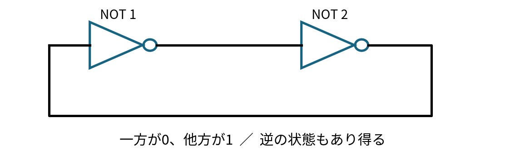
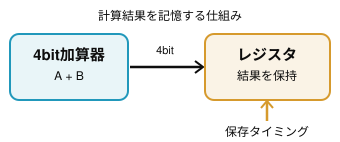

# 第7回｜記憶する回路はどう作る？

> 電子工学概論2026｜配布資料  
> **計算する回路 → フィードバック → 1bitの記憶**

## 今日の問い

前回の4bit加算器は、入力を変えると出力も変わる。では、さっきの計算結果を **「あとで使うために残す」** には、何が必要だろう？

## 1. 加算器には「過去」がない

これまで作った加算器の出力は、その時点の入力で決まる。こういう特性の回路をこの分野 (電子工学) では「**組み合わせ回路**」という。

組み合わせ回路の計算結果を保持するためには、状態を残せる回路が必要になる。

## 2. 出力を入力へ戻すと何が起きる？（フィードバック）

NOTゲート2個を輪のようにつなぐと、論理的には **「0と1」**, **「1と0」** という2通りの安定状態が存在する。外部から値を与え続けなくても、状態を保てる可能性がある。

ただし、電源投入時にどちらの状態になるかは保証されない。Logisimでは、初期状態を決められずエラーになる場合がある。

## 3. 覚える値を自分で決められない！

「0と1を保持できそう」だけでは、実用のメモリにはならない。外部から **1を書き込むSET**、**0を書き込むRESET** が必要だ。

> **考えてみよう：** フィードバックの輪っかを生かしながら、外部から値を指定するには？

## 4. 新しい論理ゲート：NAND と NOR

まずは、これまで学んだAND・ORにNOTを組み合わせたゲートを導入する。

### NAND（NOT + AND）

NANDは**ANDの出力を反転**したゲート。**両方の入力が1のときだけ出力が0**になる。

| A | B | AND | NAND |
|:---:|:---:|:---:|:---:|
| 0 | 0 | 0 |  |
| 0 | 1 | 0 |  |
| 1 | 0 | 0 |  |
| 1 | 1 | 1 |  |

### NOR（NOT + OR）

NORは**ORの出力を反転**したゲート。**両方の入力が0のときだけ出力が1**になる。

| A | B | OR | NOR |
|:---:|:---:|:---:|:---:|
| 0 | 0 | 0 |  |
| 0 | 1 | 1 |  |
| 1 | 0 | 1 |  |
| 1 | 1 | 1 |  |

## 5. SRラッチ：1bitを記憶する

NORを2個、互いの出力が相手の入力へ戻るように接続する。これにSETとRESETを加えると、0と1の記憶を操作できる。

| SET | RESET | Q（次の状態） | 意味 |
|:---:|:---:|:---:|---|
| 0 | 0 | 直前のQを保持 | 保持 |
| 1 | 0 | 1 | SET：1を書き込む |
| 0 | 1 | 0 | RESET：0を書き込む |
| 1 | 1 | Q=0、/Q=0 | 通常の記憶動作として使わない |

**注意：** SETとRESETを同時に1にしてから同時に0へ戻した場合、最終状態は保証されない。

### 5.1. Logisim で作ってみよう

Logisim で SR ラッチを作ってみよう。⇒ ワーク

### 5.2. ロジック IC で作ってみよう

Logisim で SR ラッチを作ってみよう。⇒ ワーク

## 6. コンピュータのメモリとの関係

一般的なSRAMの記憶セルも、2つのインバータが互いに状態を支えるフィードバックを基本原理としている。ただし、実際のSRAMセルには読み出し・書き込み用のトランジスタなどが追加される。

### 6.1. NAND について

授業では触れなかったが、SR ラッチ回路（記憶回路、メモリ回路）は NAND で作ることもできる。実際の製品は NAND で作られている。

## 今日の到達目標

- [ ] NORの真理値表を説明できる。
- [ ] 74HC02を使い、SRラッチを作成してSET・RESET・保持を観察する。
- [ ] 組合せ回路と、過去の状態を利用する順序回路の違いを説明できる。
