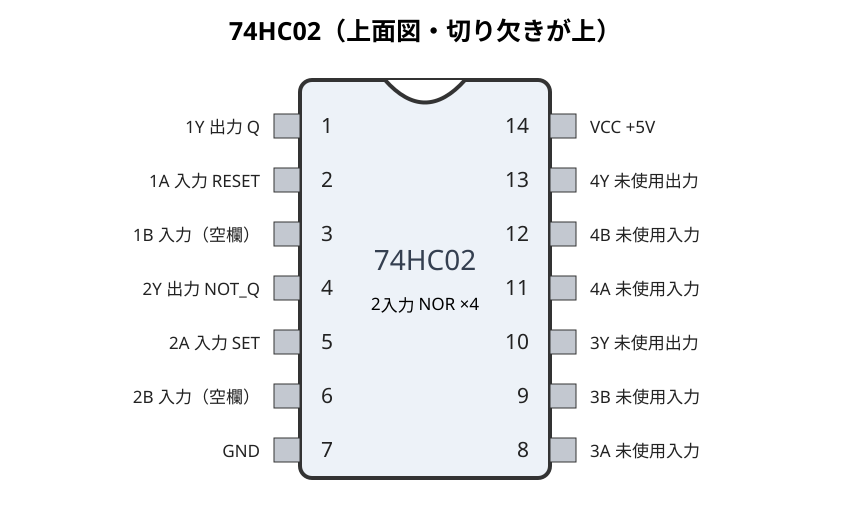
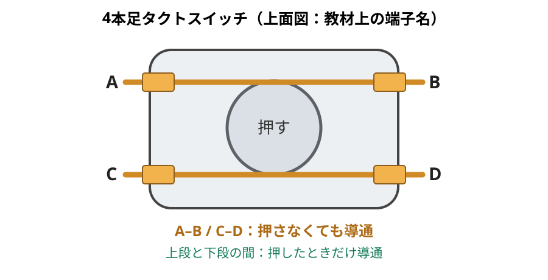
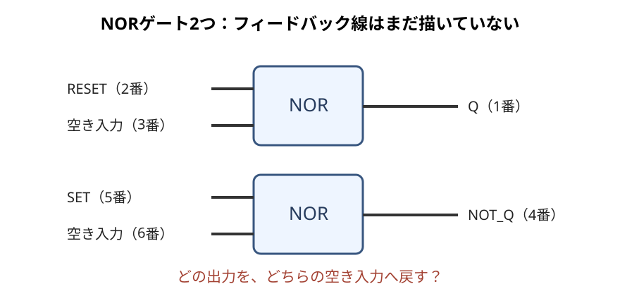

# 第7回｜SRラッチ製作ワーク

> 電子工学概論2026｜071 実習ワーク  
> 氏名：________________________　日付：________________

## 今日の課題ゴール

- [ ] **SRラッチをLogisimで作り、回路ファイル（`.circ`）を提出する。**
- [ ] **ロジックICでSRラッチ回路を作り、SET・RESET・保持の動作を先生に確認してもらう。**

作る順番は **① Logisim → ② ロジックIC**。時間があれば最後の発展課題に挑戦しよう。

---

# 1. Logisimで作る

## STEP 1｜NORゲートを2個置く

1. Logisimで新しい回路 `SR_Latch` を作る。
2. **2入力NORゲート**を2個、上下に並べる。
3. 上のNORの片方の入力を **RESET（R）**、出力を **Q** とする。
4. 下のNORの片方の入力を **SET（S）**、出力を **NOT_Q（Qの反転）** とする。
5. 各NORに、まだ使っていない入力が1本ずつ残っていることを確認する。

## STEP 2｜フィードバックの2本を自分で考える

**問い：** NORの出力を、もう一方のNORの入力へどう戻すと、状態を覚えられるだろう？

- 上のNORの空き入力 ← （　　　　　　　　　）の出力
- 下のNORの空き入力 ← （　　　　　　　　　）の出力

- [ ] 2本の線を自分で考えて接続した
- [ ] 接続したい場所が正しくつながっているか確認した

> Logisimでは、初期状態が決められず表示が不定になることがある。最初にSETかRESETの**どちらか一方だけ**を1にしてみよう。

## STEP 3｜SET・RESET・保持を確かめる

以下の順番で操作し、出力を記録しよう。

| 操作 | S | R | Q | NOT_Q |
|---|:---:|:---:|:---:|:---:|
| RESETだけを1にする | 0 | 1 | ＿＿ | ＿＿ |
| 両方0にする | 0 | 0 | ＿＿ | ＿＿ |
| SETだけを1にする | 1 | 0 | ＿＿ | ＿＿ |
| 両方0にする | 0 | 0 | ＿＿ | ＿＿ |
| RESETだけを1にする | 0 | 1 | ＿＿ | ＿＿ |

**考えてみよう：** S=R=0でも、前の値が消えないのはどうして？

＿＿＿＿＿＿＿＿＿＿＿＿＿＿＿＿＿＿＿＿＿＿＿＿＿＿＿＿＿＿＿＿＿＿＿＿

> **注意：** NOR型SRラッチでは、S=R=1は通常の記憶操作には使わない。実習では同時に1にしない。

- [ ] `SR_Latch.circ` として保存した

---

# 2. ロジック IC で作る

Logisimで動いた SR ラッチを、今度は実物のICで作ろう。**電源OFFで配線し電源を入れる。**

## STEP 1｜部品をそろえる

| 部品 | 個数 | 使い道 |
|---|:---:|---|
| **74HC02（DIP14）** | 1 | NORゲート4個入り（今回は2個使用） |
| ブレッドボード、ジャンパ線 | 1式 | 回路の配線 |
| 直流5V電源 | 1 | ICの電源 |
| 4本足タクトスイッチ | 2 | SETとRESET |
| 10kΩ抵抗 | 2 | スイッチ入力を0に保つ |
| LED | 2 | QとNOT_Qの表示 |
| 1kΩ抵抗 | 2 | LEDに流れる電流を制限 |

- [ ] ICの印字が**74HC02**であることを確認した
- [ ] 電源はOFFにしている

## STEP 2｜ICを取り付け、ピン番号を確認する

74HC02をブレッドボードの中央の溝をまたぐように差し込む。**切り欠き側から見たピン番号**を確認しよう。

    

| ピン番号 | 役割 | 今回のつなぎ先 |
|---|---|---|
| **14** | VCC | +5V |
| **7** | GND | GND |
| **2** | 上のNORの入力 | RESETスイッチ |
| **1** | 上のNORの出力 | QのLED |
| **5** | 下のNORの入力 | SETスイッチ |
| **4** | 下のNORの出力 | NOT_QのLED |
| **3、6** | 残りの入力 | **最後に自分で考える2本の線** |
| 8、9、11、12 | 今回使わない入力 | GND |
| 10、13 | 今回使わない出力 | 何もつながない |

※ブレッドボードの電源レールは途中で切れていることがある。つながっている範囲を確認しよう。

## STEP 3｜電源とスイッチを先に作る

### ここが重要！ タクトスイッチの4本の足

4本足のタクトスイッチは、**好きな2本を選べばスイッチになるわけではない**。毎年ここで配線を間違えやすい。

    

この図のように、**上段をA–B、下段をC–D** と名付ける。

| 端子の組合せ | 押していない | 押している | スイッチになる？ |
|---|:---:|:---:|:---:|
| **A–B、C–D** | 導通 | 導通 | **ならない** |
| **A–C、A–D、B–C、B–D** | 非導通 | 導通 | **なる** |

**A–BとC–Dは、押さなくてもつながっている。上段から1本、下段から1本を選ぶこと。** 端子の見え方は実物の向きで変わるので、必要ならテスターで確かめよう。

- [ ] 押さなくても導通するペアを確認した
- [ ] 押したときだけ導通するペアを選んだ

### 電源・SET・RESETの配線

1. ICの **14番を+5V**、**7番をGND** へ接続する。
2. **RESET用：** スイッチを押したとき、+5VがICの**2番**につながるようにする。
3. ICの **2番** から **10kΩ抵抗を通してGND** へつなぐ。
4. **SET用：** スイッチを押したとき、+5VがICの **5番** につながるようにする。
5. ICの **5番** から **10kΩ抵抗を通してGND** へつなぐ。
6. 使わないNORの入力（**8、9、11、12番**）をGNDへつなぐ。出力（10、13番）は何もつながない。

| ボタンを離す | ボタンを押す |
|---|---|
| 10kΩ抵抗によって入力は **0** | +5Vにつながり入力は **1** |

- [ ] SETとRESETは、**押している間だけ1** になる配線にした
- [ ] 10kΩ抵抗は **2本** とも使った

## STEP 4｜QとNOT_QのLEDをつける

LEDは向きに注意。**1kΩ抵抗を必ず直列に** 入れる。

- **Qの表示：** ICの **1番 → 1kΩ抵抗 → LEDのアノード（＋） → カソード（－） → GND**
- **NOT_Qの表示：** ICの **4番 → 1kΩ抵抗 → LEDのアノード（＋） → カソード（－） → GND**

LEDの長い足は通常アノード、短い足は通常カソード。部品の形状でも確認しよう。

- [ ] LED2個、それぞれに1kΩ抵抗を入れた
- [ ] LEDの向きを確認した
- [ ] **まだ電源は入れない**

## STEP 5｜最後のフィードバック2本は自分で考える

Logisimで作った回路を思い出そう。

    

**上のNORの出力は1番、下のNORの出力は4番。残っている入力は3番と6番。**

- **3番入力 ← （　　　）番出力**
- **6番入力 ← （　　　）番出力**

1. 空欄に答えを書こう。
2. **電源OFFのまま** フィードバック線を2本つなごう。
3. 先生に回路を見てもらってから、電源を入れよう。

- [ ] 2本を自分で考えて配線した
- [ ] 出力同士を直接つないでいない
- [ ] 先生に通電前の確認をしてもらった

## STEP 6｜SET・RESET・保持を先生に見せる

**SETとRESETを同時には押さない。**

| 操作 | QのLED | NOT_QのLED |
|---|---|---|
| RESETを押す | ＿＿ | ＿＿ |
| RESETを離す | ＿＿ | ＿＿ |
| SETを押す | ＿＿ | ＿＿ |
| SETを離す | ＿＿ | ＿＿ |
| もう一度RESETを押す | ＿＿ | ＿＿ |

- [ ] SETでQが1になり、ボタンを離しても保持した
- [ ] RESETでQが0になり、ボタンを離しても保持した
- [ ] **先生に動作を確認してもらった**

うまくいかないときは **電源OFF** にして、ICの向き、タクトスイッチの端子、LEDの向き、抵抗、フィードバック2本を確認しよう。

---

# 発展課題（早く終わった人向け・Logisim）

**今まで習ったものだけ** で、もう少しコンピュータらしい回路にしてみよう！

## 発展1｜4bit加算器の計算結果を覚えさせよう

前回の **4bit加算器** と今回の **SRラッチ** を組み合わせる。

1. Logisimで、前回作った4bit加算器を置く。
2. 今回作ったSRラッチを **4個** 用意する。
3. 加算器の4本の和の出力を、各SRラッチの **S（SET）入力** へ1本ずつつなぐ。
4. 4個の **R（RESET）入力はすべて0** にしておく。
5. 最初は各ラッチのRを一度1にして0に戻し、**記憶値を0000にしてから** 計算してみよう（R=1 のとき S=1 にしないこと）。

**試してみよう**

| 操作 | 加算器の出力 | 記憶している4bit |
|---|:---:|:---:|
| 最初にすべてRESET | 0000 | ＿＿＿＿ |
| `0011 + 1100` | 1111 | ＿＿＿＿ |
| 次に `0001 + 0010` | 0011 | ＿＿＿＿ |
| 次に `0000 + 0000` | 0000 | ＿＿＿＿ |

**考えてみよう**

- 計算結果が **1** になったビットは、S入力によってどうなる？
- 計算結果が **0** に戻っても、記憶した1が消えないのはなぜ？

> この回路では、**1は書き込めるが、計算結果の0で上書きはできない**。それでOK！ 今回はSRラッチのS入力の働きを確かめる実験だよ。

## 発展2｜RESETスイッチで4bitをゼロクリアしよう

4個のSRラッチの **R入力** に、**同じRESETスイッチ** をつないでみよう。

1. 加算器の入力を両方 `0000` にする（S入力を全部0にする）。
2. 共通のRESETスイッチを押し、記憶した4bitが **0000** になるか確認する。
3. RESETを離す。**0000のまま保持** されるか確認する。
4. もう一度計算して、1を書き込めることを確かめよう。

**考えてみよう**

- RESETスイッチを離してRが0に戻っても、なぜ0のままなのだろう？
- 4bitを32bitにしたいなら、**SRラッチは何個必要** だろう？

> **注意：** 加算結果に1が残ったままRESETすると、同じラッチのSとRが両方1になることがある。**必ず加算器の出力を0000にしてからRESET** しよう。

新しい種類の回路は必要ない。**計算する回路を並べる。記憶する回路も並べる。** これだけで、少しコンピュータらしくなってきた！

---

# 提出・片付け

- [ ] **Logisimの `SR_Latch.circ` を提出した**
- [ ] **実物のSRラッチの動作を先生に確認してもらった**
- [ ] 電源をOFFにして、部品を片付けた

※発展課題は任意。できた人はLogisimファイルも保存しておこう。
