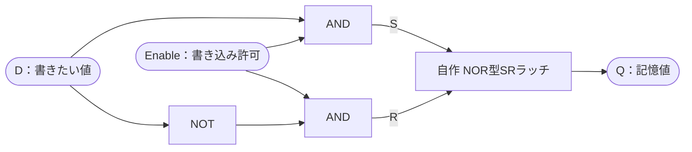
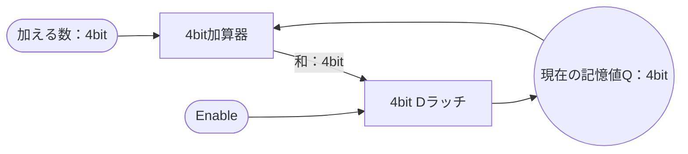
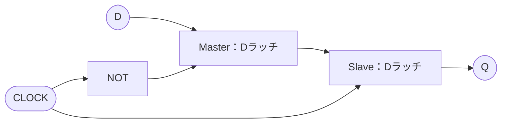
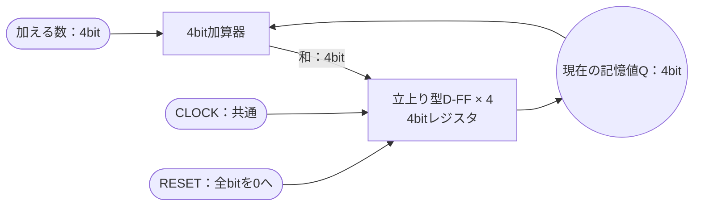

# 第8回　前の計算結果を、次の計算に使おう！

電子工学概論2026｜講義資料  
使用ソフト：Logisim-evolution v5.0.0

## 今日の目標

第6回には**4bit加算器**で計算ができました。第7回には**NOR型SRラッチ**で1bitを記憶できました。

今日は、この2つを組み合わせて、**前の計算結果に新しい数を足す回路**を作ります。

たとえば、最初は0だった記憶値に、3、5、2を順に足して、`0 → 3 → 8 → 10`と更新できる装置が目標です。

このように、**計算結果を記憶し、そこへ次の数を加えていく装置を「累算器（アキュムレータ）」** と呼びます。「累算」は足し算を積み重ねるという意味です。

## 1．SRラッチを思い出そう

第7回に作ったNOR型SRラッチ（SとRが1で有効になる型）の動作を確認します。

| S | R | Qの動作 |
|:---:|:---:|---|
| 1 | 0 | 1を記憶する（SET） |
| 0 | 1 | 0を記憶する（RESET） |
| 0 | 0 | 前の値を保持する |
| 1 | 1 | 通常の記憶操作には使わない |

### 考えてみよう

加算器の出力を、SRラッチの**S入力だけ** につなぎ、R=0とします。

加算器の出力が**1になるとS=1**となるので、SRラッチは**1を記憶できます**。

では、最初に`1`を記憶したあと、加算器の出力を`0`に変えたら、Qは0に書き換わるでしょうか。

**考えるポイント**：S=0は「0を書き込む」という意味でしたか。

SRラッチでは、SとRを正しく使えば0も1も記憶できます。しかし、加算結果をそのまま書き込むには、少し工夫が必要です。

## 2．1本の入力Dで、0も1も書きたい

ここで、書きたい値を **D（Data：データ）** と呼ぶことにします。

### 問い①　SとRをどう操作すればよい？

| 書きたい値 D | S | R |
|:---:|:---:|:---:|
| 0 | ？ | ？ |
| 1 | ？ | ？ |

考えてから、次を読みましょう。

D=1のときはSET、D=0のときはRESETになるようにすれば、1本のD入力で両方を書き込めます。

- `S = D`
- `R = NOT D`

ただし、このままでは**Dが変わるたびにQも変わってしまいます**。これでは、**記憶した値を好きなタイミングまで保持しておくことができません**。

### 問い②　書き換えたくないときはどうする？

そこで、好きなタイミングで**書き込みを許可したり、禁止したり**できる信号を設けます。

この信号を **Enable（イネーブル）** といいます。英語で「**有効にする**」という意味です。この回路では、記憶の書き込みを許可するかどうかを決めます。

- **Enable=0**：書き込みを無効にする → 今のQを保持する。
- **Enable=1**：書き込みを有効にする → その**間ずっと**QはDに追従する。

これを実現する回路が**Dラッチ**です。

### NOR型SRラッチからDラッチを作る

第7回のNOR型SRラッチに、**NOTを1個、ANDを2個**追加します。

```text
S = Enable AND D
  = 書き込み許可 AND データが1
  → SET（1を記憶する）

R = Enable AND (NOT D)
  = 書き込み許可 AND データが0
  → RESET（0を記憶する）
```

Enable=0ならSもRも0になるため、SRラッチは前の状態を維持します（保持）。



この構成では、SとRが同時に1になることはありません。

| Enable | D | Qの動作 |
|:---:|:---:|---|
| 0 | 0 | 前のQを保持 |
| 0 | 1 | 前のQを保持 |
| 1 | 0 | Q=0 |
| 1 | 1 | Q=1 |

**重要**：Dラッチは、Enableが1になった**瞬間だけ**書き込む回路ではありません。**Enableが1である間、入力Dに追従する**回路です。

ここまでをLogisimで製作し、確かめます（実習ワークの課題1）。

## 3．「前の結果に、次の数を足す」回路を考える

作りたい装置（アキュムレータ）の動作を考えましょう。

1. 今の記憶値Qを読み出す。
2. Qに「加える数」を足す。
3. その和を、新しい記憶値Qとして保存する。
4. 次の数でも同じ操作を繰り返す。

### 問い③　どこに線を戻せばよい？

加算器の一方の入力には「加える数」を入れます。もう一方の入力には何をつなぎますか。加算器の和は、どこへ送りますか。

Dラッチを使って考えると、次のようになります。



この図は、**うまくいくか確かめるための構成**です。完成したアキュムレータではありません。

### なぜ問題が起きるのだろう？

加算器は、入力が変われば和も変わる回路です。一方、Dラッチは **Enableが1の間**、Dの値がQに伝わります。

その状態でQを加算器に戻すと、

**Qが変わる → 和が変わる → Dが変わる → Qがまた変わる**

というつながりが生まれます。つまり、**一度の書き込み操作で、計算結果を1回だけ確定することができません**。

Logisimでは、このような回路が安定せず、`Oscillation apparent`（明らかなオシレーション）などと表示される場合があります。**このままでは、考えていた「1回の操作で1回だけ足し算し、その結果を記憶する回路」にはなりません。**

## 4．必要な記憶回路の働きを考える

### 問い④

> 加算結果を**決まった瞬間に1回だけ取り込み**、次の合図が来るまでは**同じ値を保持する**には、記憶回路にどんな働きが必要でしょうか。

この働きを持つ部品が、**Dフリップフロップ（D-FF）** です。

Dラッチでは、Enable信号を使って、書き込みを許可するかどうかを決めました。しかし、加算器と組み合わせると、Enableが1の間は何度も計算結果が更新されようとします。

そこで、**決まったタイミングで値を更新する**ことを考えます。コンピュータの内部では、動作のタイミングをそろえるために、**クロック（Clock）信号**が使われます。クロックは通常、**一定の周期で0と1を繰り返す信号**です。

D-FFには、クロックが **0から1へ変わる瞬間（立上り）** にDの値を取り込むものと、**1から0へ変わる瞬間（立下り）**に取り込むものがあります。今回は**立上りで取り込むD-FF** を使います。

DラッチはEnableが1の**間**に入力へ追従します。一方、D-FFはクロックが指定の向きに変わる**瞬間**に値を取り込み、それ以外は保持します。

| 回路 | Qが書き換わるタイミング |
|---|---|
| **Dラッチ** | Enable=1の**間**、Dに追従する |
| **D-FF（立上り型）** | クロックが**0→1になる瞬間**にDを取り込み、それ以外は保持する |

### 動作を追ってみよう

最初にQ=0にしておきます。

| 操作 | CLOCK | D | Q |
|---|:---:|:---:|:---:|
| 最初に0へ初期化 | 0 | 0 | 0 |
| Dだけ1に変える | 0 | 1 | 0 |
| CLOCKを0→1にする | ↑1 | 1 | 1 |
| Dだけ0に変える | 1 | 0 | 1 |
| CLOCKを1→0にする | ↓0 | 0 | 1 |
| CLOCKを0→1にする | ↑1 | 0 | 0 |

**見てほしい点**：Dが変わっても、Qはすぐには変わりません。クロックの変化でQが更新されます。

Logisimでは、手動でクロックを進めると、0と1の変化を確かめやすくなります。タイミングチャート（信号の0/1を時間に沿って描いた図）も利用できます。

## 5．D-FFを自分で作るには？

D-FFは、クロックが変化する瞬間に入力Dを記憶し、それ以外は保持する回路でした。

### 考えてみよう

これまでに学んだ回路を工夫して、**D-FFと同じ働きをする回路** を作れないでしょうか。

DラッチはEnableが1の間、入力Dに追従します。この性質を利用しながら、外から見たQが**クロックの瞬間だけ**変わるようにする方法を考えてみてください。

### ヒント：Dラッチを2個使う

Dラッチを前後に2個つないでみましょう。ただし、両方のEnableを同時に1にすると、Dの変化が最後のQまで伝わってしまいます。

**2個のDラッチを、どんな順番で有効にしたらよいでしょうか？**

### 2枚のドアで考えてみよう

前後に並んだ2枚のドアを想像してください。

- **前のドアが開いている間は、後ろのドアを閉じる。**
- **前のドアを閉じてから、後ろのドアを開く。**
- こうすれば、入口の変化が出口まで一度に通り抜けるのを防げます。

前のDラッチを **Master（前段）**、後ろを **Slave（後段）**と呼び、クロックを使って交互に有効にする方式を **マスター・スレーブ方式** といいます。

立上り型を考える場合、MasterのEnableには`NOT CLOCK`、SlaveのEnableには`CLOCK`をつなぎます。



- CLOCK=0：MasterがDに追従し、Slaveは保持します。
- CLOCKが0→1：Masterは保持へ切り替わり、SlaveがMasterの値を受け取ります。
- CLOCK=1：Masterは保持しているので、外部Dを変えても最終出力Qは追従しません。

※ここでは仕組みを理解するために、信号が伝わる時間を省略して説明しています。2段のDラッチの自作は**任意の発展課題**です。

## 6．4bitアキュムレータを完成させよう

**D-FFを4個**集めると、4bitの値を記憶する**レジスタ（register：複数bitの記憶回路）**になります。

4bit加算器と、この4bitレジスタを組み合わせると、**アキュムレータ（累算器）** を作れます。



4個のD-FFは、**同じクロック**でまとめて更新します。RESETでは記憶値を`0000`に戻します。

| 操作 | 記憶値Q（2進数） | 10進数 |
|---|:---:|---:|
| RESET | `0000` | 0 |
| 3を加え、クロックを立上げる | `0011` | 3 |
| 5を加え、クロックを立上げる | `1000` | 8 |
| 2を加え、クロックを立上げる | `1010` | 10 |
| RESET | `0000` | 0 |

### 4bitで表せる数を超えたら？

4bitで表せる数は0〜15です。たとえば`1111`（15）に`0001`（1）を足すと、結果は`1 0000`（16）になります。今回の4bitアキュムレータでは、あふれた上位の桁を記憶しないため、Qは`0000`（0）に戻ります。

実際のCPUにも、計算で**桁上がり**が発生したことを知らせる仕組みがあります。その印を**キャリーフラグ（Carry Flag）**と呼びます。これは、符号付き数の範囲を超えたことを示す「オーバーフローフラグ」とは区別します。

実習ワークの課題2で、実際に回路を完成させましょう。

## 7．コンピュータへ、もう一歩

これまでに作った回路を整理します。

| 機能 | 今までに学んだ回路 |
|---|---|
| **計算する** | 半加算器・全加算器・4bit加算器 |
| **記憶する** | SRラッチ・Dラッチ・D-FF・レジスタ |
| **決まったタイミングで更新する** | クロックとD-FF |

### 最後の問い

今のアキュムレータは、クロックが来るたびに足し算の結果を記憶します。

**足し算をしない、別の計算をする、書き込みを止める――そんな動作を選ぶには、あと何が必要でしょうか。**

コンピュータでは、**計算・記憶**だけでなく、**何をいつ行うか決める「制御」** も大切です。

たとえば制御部は、先ほど紹介した**キャリーフラグ** などの情報を、プログラムの命令と組み合わせて利用できます。桁上がりが起きたら別の処理へ進む、プログラムを終了する処理へ進む、といった流れも作れます。

※キャリーフラグが立つだけで、自動的にプログラムが止まるわけではありません。

命令やデータを保存するメモリなども組み合わさることで、コンピュータは複雑な処理を実行できます。

### 今日のまとめ

1. **Dラッチ**は、Enableが1の**間**、入力Dに追従する。
2. **D-FF**は、クロックの指定された**瞬間**に入力Dを記憶する。
3. **加算器＋レジスタ**で、前の計算結果を次の計算に使える。
