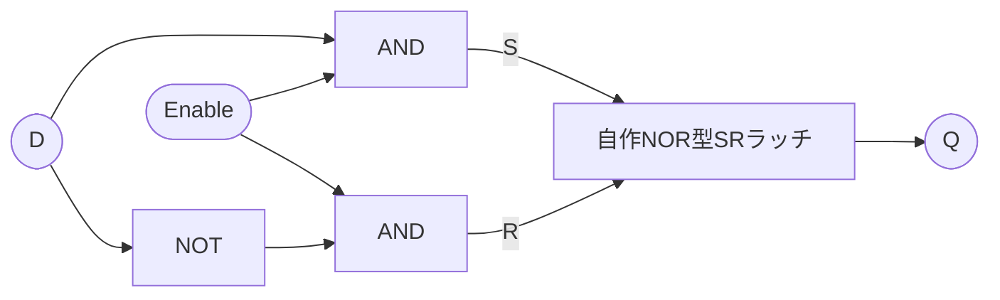
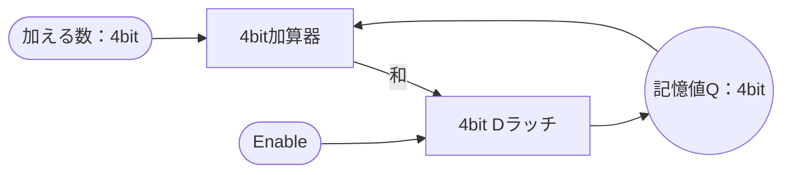
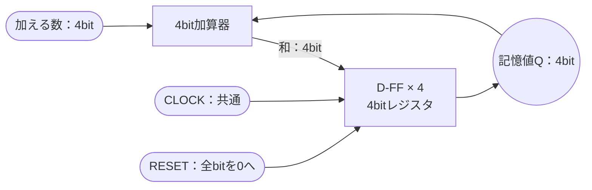

# 第8回　Logisim実習ワーク

## Dラッチを作り、4bitアキュムレータを完成させよう

電子工学概論2026｜実習資料  
使用ソフト：**Logisim-evolution v5.0.0**

**今日のゴール**：NOR型SRラッチから1bit Dラッチを作り、4bit加算器とD-FFで「前の結果に次の数を足す回路（累算器・アキュムレータ）」を完成させる。

## 準備

用意するもの：

- [ ] 第7回のNOR型SRラッチの回路（`SR_Latch.circ`など）
- [ ] 第6回の4bit加算器の回路
- [ ] Logisim-evolution v5.0.0
- [ ] 回路を保存するフォルダ

以前の回路ファイルが見つからない場合は、担当教員に申し出てください。

> **注意**：回路を変更したら、その都度保存しましょう。配線が交差する場所では、接続点があるかを確認しましょう。

---

## 課題1【必須】NOR型SRラッチからDラッチを作る

### 1-1．どんな動作が必要？

入力を次のように呼びます。

- **D（Data）**：書き込みたい値（0または1）。
- **Enable（イネーブル）**：「有効にする」という意味。ここでは**書き込みを許可する信号**。
- **Q**：記憶している値。

まず、次の表の空欄を埋めてください。

| Enable | D | Qはどうなる？ |
|:---:|:---:|---|
| 0 | 0 |  |
| 0 | 1 |  |
| 1 | 0 |  |
| 1 | 1 |  |

**Qの欄には「0」「1」「前の状態を維持する（保持）」のどれかを書きましょう。**

**ヒント**：Enable=0では書き込みをしません。Enable=1では書き込みが有効です。

### 1-2．回路を設計する

使う部品：

- 自作のNOR型SRラッチ（NOR×2）
- NOT×1
- AND×2
- D入力、Enable入力、Q出力

次の関係を満たすように配線します。

```text
S = Enable AND D
  = 書き込み許可 AND データが1
  → SET（1を記憶する）

R = Enable AND (NOT D)
  = 書き込み許可 AND データが0
  → RESET（0を記憶する）
```

Enable=0のときはSもRも0となり、SRラッチは前の状態を維持します（保持）。



この図は**接続の関係を示した概念図**です。Logisimでの部品の向きや配線の位置は自由です。

### 1-3．「回路を追加」を使って製作する

**これまでに作ったSRラッチを、1つの部品として再利用**します。新しい回路を追加しても、元のSRラッチは残せます。

1. 第7回に作ったNOR型SRラッチの`.circ`ファイルを開きます。
2. 元のSRラッチに、**S・Rの入力ピン**と**Qの出力ピン**があることを確認します。ピンがなければ取り付け、名前も付けておきます。
3. メニューの **Project（プロジェクト）→ Add Circuit（回路を追加）** を選びます。
4. 新しい回路名を`D_Latch`にします。左側の回路一覧に、元のSRラッチと`D_Latch`の両方があることを確認します。
5. `D_Latch`を開き、左側の回路一覧から**自作SRラッチを部品として配置**します。
6. **NOTを1個、ANDを2個**配置します。
7. **入力ピンDとEnable**、**出力ピンQ**を配置し、名前を付けます。
8. Dを2つに分岐させます。一方はANDへ、もう一方はNOTを通して別のANDへつなぎます。
9. Enableを2個のANDへつなぎます。
10. 2個のANDの出力を、自作SRラッチの**SとR**へつなぎます。
11. SRラッチのQを`D_Latch`の出力ピンQへつなぎます。
12. 保存します。**元のSRラッチの回路を消さないこと**を確認してください。

※元のSRラッチを部品として置いたとき、S・R・Qの端子が見えない場合は、元の回路の入出力ピンの設定を見直しましょう。

### 1-4．動作を確認する

Enableが**0の間は保持**し、**1の間は書き込みが有効**になることを、順番に確認しましょう。

- [ ] Enableを1、Dを0にすると、Q=0になった。
- [ ] Enableを0にすると、Dを1に変えても、Q=0のままだった。
- [ ] Enableを1にすると、Q=1になった。
- [ ] **Enableを0にすると、Dを0に変えても、Q=1のままだった。**
- [ ] Enableを1にすると、Q=0になった。
- [ ] Enableを0に戻してDを変えても、Qは変わらなかった。

**確認**：Enableが0のときと1のときでは、Dの変化に対してQはどう違いましたか？

**考察1**：「Enable=1になった瞬間だけ書き込む」のと、「Enable=1の間ずっとDに追従する」のとでは、今回のDラッチはどちらですか。

回答：

＿＿＿＿＿＿＿＿＿＿＿＿＿＿＿＿＿＿＿＿＿＿＿＿＿＿＿＿

---

## 観察1　加算器とDラッチをつなぐと？

目指すのは、次の動作です。

**現在のQ ＋ 加える数 → 和を記憶 → 次の計算で使う**



上の図を見て、考えてください。

1. 加算器が和を出した直後、DラッチのQが変わると、加算器の入力はどうなりますか。
2. Enable=1の間、Dラッチはどのように動きますか。
3. 1回の操作で1回だけ足したいとき、この構成で困ることは何ですか。

観察したこと、考えたこと：

＿＿＿＿＿＿＿＿＿＿＿＿＿＿＿＿＿＿＿＿＿＿＿＿＿＿＿＿

＿＿＿＿＿＿＿＿＿＿＿＿＿＿＿＿＿＿＿＿＿＿＿＿＿＿＿＿

**注意**：この回路は完成形ではありません。Logisimでは`Oscillation apparent`と表示されたり、値が不定になったりすることがあります。

---

## 観察2　決まった瞬間だけ記憶するには？

### 2-1．まず必要な働きを考える

**問い**：加算器の和を、合図が来た**瞬間だけ**取り込み、次の合図までは前の値を保持するには、どんな記憶回路が必要でしょうか。

回答：

＿＿＿＿＿＿＿＿＿＿＿＿＿＿＿＿＿＿＿＿＿＿＿＿＿＿＿＿

この働きを持つ部品が**D-FF（Dフリップフロップ）** です。

DラッチではEnableが1の**間**、Dに追従します。これに対し、D-FFでは**クロック（Clock）**という信号で取り込むタイミングを決めます。クロックは通常、一定の周期で0と1を繰り返します。

D-FFには、クロックが**0→1へ変わる瞬間（立上り）**に取り込むものと、**1→0へ変わる瞬間（立下り）**に取り込むものがあります。今回は**立上り型**を使います。

### 2-2．1bitのD-FFを調べる

1. Logisimの部品一覧から**D Flip-Flop**を配置します（通常はMemoryの中）。
2. **D**に1bitの入力ピン、**Q**に出力ピンまたはProbeをつなぎます。
3. **CLOCK**端子にClock部品（通常はWiringの中）を接続します。
4. D-FFの属性で**立上りエッジ**で動作するように設定します。
5. 初期化に使うClear端子がある場合は、**有効になる値（0か1か）** を確認してQ=0にします。通常の確認中はClearを無効な状態に戻します。
6. 自動クロックを停止し、**シミュレーション（Simulate）** メニューの**Manual Tick Half Cycle（手動で半周期進める）**などを使ってCLOCKを1段階ずつ進めます。
7. CLOCKが今0か1かを見て、**0→1の立上り**を確認します。

※画面の日本語訳は環境によって異なることがあります。メニューや部品の名称が違う場合は、教員の画面で確認してください。

### 2-3．値を書き込んでみる

| 操作 | CLOCK | D | Q（実際に見た値） |
|---|:---:|:---:|:---:|
| 初期化して0にする | 0 | 0 | |
| Dだけを1にする | 0 | 1 | |
| CLOCKを0→1にする | 1 | 1 | |
| Dだけを0にする | 1 | 0 | |
| CLOCKを1→0にする | 0 | 0 | |
| CLOCKを0→1にする | 1 | 0 | |

### 2-4．タイミングチャートで確かめる（できる範囲で）

タイミングチャートとは、**信号の0と1の変化を、時間の順に並べた図**です。

1. D、CLOCK、Qを区別できるように名前を付けます。
2. **Simulate**メニューからタイミングチャート（Timing diagram／Chronogram相当）を開きます。
3. D、CLOCK、Qを観察信号に追加します。
4. クロックを手動で進め、**どの変化でQが書き換わったか**を調べます。

タイミングチャートが使えない場合でも、回路上のD・CLOCK・Qの0/1を確かめられれば、次の課題に進めます。

---

## Probe（プローブ）で信号の値を調べよう

**Probe（プローブ）** は、回路の配線につないで、その場所の信号の値を確認する部品です。回路の働きを変えるのではなく、**値を観察する**ために使います。

1. 左側の部品一覧から **Wiring（配線）→ Probe** を選びます。
2. 値を調べたい配線にProbeをつなぎます。
3. 入力を変え、Probeに表示される値を確かめます。
4. 4bitの値を`0011`などの**2進数**で見たいときは、Probeの属性で表示形式（Radix）を2進数にします。

※1bitの配線なら0または1が表示されます。4bitをまとめた配線なら4bit全体を確認できます。

---

## 課題2【必須】4bitアキュムレータを作る

**アキュムレータ（累算器）** とは、前の計算結果に新しい数を足していく回路です。

**4bitレジスタ**は、1bitを記憶するD-FFを4個集めたものです。



この図も**接続関係の概念図**です。実際のLogisimでは、4bitを4本に分けるときにSplitterなどを使います。

### 3-1．必要な部品

- [ ] 第6回の4bit加算器×1
- [ ] 既製のD-FF×4（立上り型）
- [ ] 「加える数」の4bit入力
- [ ] Clock×1
- [ ] RESET入力×1
- [ ] Q（4bit）の表示
- [ ] 必要に応じてSplitterやProbe

### 3-2．配線する

1. **Project → Add Circuit（回路を追加）** で、`Accumulator4`という新しい回路を作ります。第6回の自作4bit加算器をこのプロジェクトで使えるようにします。別の`.circ`ファイルに保存している場合は、元の回路から配線をコピーするなどして取り込みます。
2. 「加える数」の4bit入力を、加算器の一方の入力へつなぎます。
3. **既製D-FFを4個**置きます。各D-FFのD、Qは、それぞれ1bitです。
4. 加算器の和4bitを4本に分け、各D-FFの**D**につなぎます（bit0〜bit3の順序に注意）。
5. 4個のD-FFの**Q**を4bitにまとめ、加算器のもう一方の入力へ戻します。
6. 同じQの4bit信号を**Probe（プローブ）**にもつなぎ、記憶値を2進数で読めるようにします。
7. 4個のD-FFのCLOCK端子を**1個のClockに共通接続**します。
8. 4個のD-FFのClear端子を、**1個のRESET入力に共通接続**します。部品の属性を見て、RESETがどちらの値で有効になるか確認します。
9. 使わない入力端子がある場合は、未接続のままにせず、部品の仕様に合わせて0/1を定めます。
10. 回路を保存します。

### 3-3．途中確認

- [ ] 加算器の2つの入力は「加える数」と「現在のQ」である。
- [ ] 和のbit0〜bit3が、対応するD-FFのDへつながっている。
- [ ] Qの4bitが加算器へ戻り、表示にもつながっている。
- [ ] 4個のD-FFが同じCLOCKにつながっている。
- [ ] RESETでQが`0000`になる。
- [ ] 「加える数」を変更するだけではQは変わらない。

### 3-4．必須の動作確認

**自動クロックを停止**し、1回ずつCLOCKを操作します。各行でクロックの**立上り（0→1）**が起きるようにしてください。次の計算前にはCLOCKを0へ戻します。

| 手順 | 操作 | 期待するQ | 確認 |
|:---:|---|:---:|:---:|
| 1 | RESET | `0000` | □ |
| 2 | 加える数を`0011`（3）にして立上り | `0011` | □ |
| 3 | 加える数を`0101`（5）にして立上り | `1000` | □ |
| 4 | 加える数を`0010`（2）にして立上り | `1010` | □ |
| 5 | RESET | `0000` | □ |

**考察2**：Dラッチでは困ったことが、D-FFを使うと解決できるのはなぜですか。2〜3行で説明してください。

考察1と考察2は、**Wordファイル（`.docx`）に文章でまとめます**。

＿＿＿＿＿＿＿＿＿＿＿＿＿＿＿＿＿＿＿＿＿＿＿＿＿＿＿＿

＿＿＿＿＿＿＿＿＿＿＿＿＿＿＿＿＿＿＿＿＿＿＿＿＿＿＿＿

---

## 困ったとき：`Oscillation apparent`が出たら

`Oscillation apparent`は、Logisimで信号の値が安定せず、シミュレーションを続けられないときに出る表示です。**必ずしも配線ミスとは限りません。**

### SRラッチやDラッチを製作中の場合

1. **NORの交差接続**と、S・R・Qの位置を確認する。
2. Dラッチなら、NOT・AND・Enableの接続を確認する。
3. SRラッチは、`S=1,R=0`（SET）または`S=0,R=1`（RESET）で値を確定できる。Dラッチでは、`Enable=1`としてD=0またはD=1を書き込む。
4. **接続や入力を修正した後**、必要ならシミュレーションメニューの**Reset Simulation（シミュレーションのリセット）**を使い、再び実行する。
5. 直らない場合は、現在の入力値をそのままにして教員へ相談する。

**注意**：SRラッチの`S=R=0`は正常な「保持」の条件です。ただし、最初の記憶値が決まっていないと、シミュレータ上で値が定まらないことがあります。

### 加算器とDラッチをフィードバック接続した場合

Enable=1の間はDラッチが入力に追従するため、**更新後のQがすぐ次の計算に使われる**ことが問題になります。これは回路の構造によるもので、初期化するだけでは解決しません。最終課題では**D-FFを使用**します。

---

## 発展課題【任意】Dラッチを2個使ってD-FFを作る

必須のアキュムレータが完成してから挑戦してください。

1. 課題1のDラッチを2個用意します。
2. 1個目（**Master：前段**）のQを、2個目（**Slave：後段**）のDへつなぎます。
3. MasterのEnableに**NOT CLOCK**、SlaveのEnableに**CLOCK**をつなぎます。
4. **D、CLOCK、MasterのQ、SlaveのQ**を観察します。
5. CLOCK=0の間、MasterはDに追従し、Slaveは保持することを確かめます。
6. CLOCKが0→1になったとき、SlaveのQがどう変わるか確かめます。
7. 既製のD-FFと動作を比較し、同じ点・異なる点を数行でまとめます。

**ヒント：「2枚のドア」**。前のドアが開いている間は後ろを閉じ、切り替えると前が閉じて後ろが開くようにします。

※シミュレーションでは初期値や信号の伝わる時間のため、期待通りに動かない場合もあります。

---

## 提出と終了確認

### 必須の提出物

- **Logisim回路ファイル（`.circ`）を1つ**：`SR_Latch`、`D_Latch`、`Accumulator4`の回路を1つのプロジェクト内に保存します（元の回路名は実際に使った名前で構いません）。
- **Wordファイル（`.docx`）を1つ**：考察1と考察2の回答を、見出しを付けてまとめます。

### 提出方法

**Google Classroomの第8回課題に、`.circ`ファイルと`.docx`ファイルの計2つを添付して提出**してください。提出前に、`.circ`を開いてDラッチとアキュムレータの両方が入っていることを確認しましょう。

### 任意の発展課題について

Dラッチ2段で作ったD-FFも、同じ`.circ`ファイルの別回路として追加して構いません。比較の説明はWordファイルの末尾に「発展課題」として書いてください。

### 最後のチェック

- [ ] Dラッチの**保持**と**追従**を確認できた。
- [ ] D-FFはクロックの**立上り**で値を記憶すると確認できた。
- [ ] アキュムレータで`0000 → 0011 → 1000 → 1010 → 0000`を確認できた。
- [ ] 回路を保存し、提出できた。

**今日の結論**：**計算する回路＋記憶する回路＋クロックでの更新**を組み合わせると、前の計算結果を次の計算に使える。
